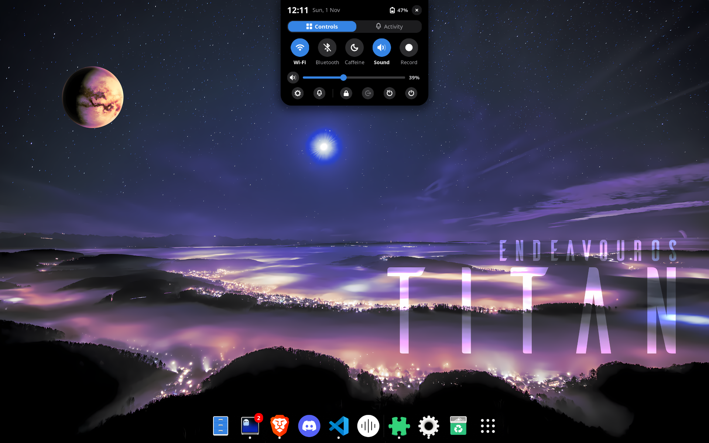
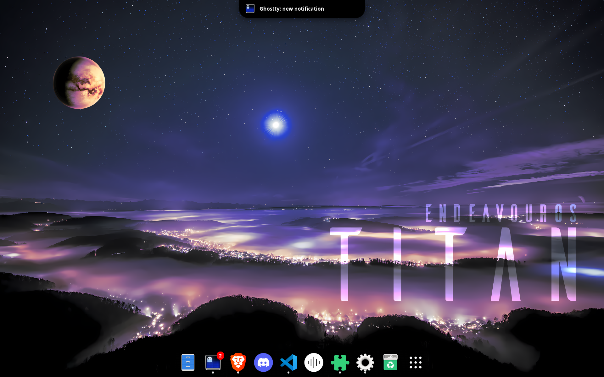
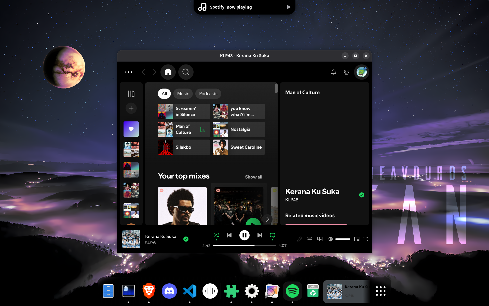

# Islet

A notch-style "island" for GNOME Shell. Islet puts a compact clock and status indicators at the top
edge of the screen, expands on hover into quick controls and recent activity, and can show
notifications and now-playing music as a short "Peek" instead of the stock banners.

> **Status: development candidate.** Targets GNOME Shell 50.5 on Wayland. Compatibility with other
> versions is not certified. Local UUID: `islet@local`. No bundler, notification server, database,
> or extra daemon is involved.

## Features

- **Compact notch**: clock plus network and battery icons at the top edge.
- **Expanded view** (about 320 px wide): clock, date, battery and close button, Controls and
  Activity tabs, round toggles (Wi-Fi, Bluetooth, Caffeine, Sound), a volume row, and a row of
  small icon buttons (open GNOME Settings, notification settings, lock, log out, restart, power
  off). A Record tile opens GNOME's screen recording UI and turns into Stop while recording.
- **Notification Peek**: optionally redirects banners to the notch. Privacy Mode (on by default)
  hides titles, bodies, and actions.
- **Music Peek**: shows the cover art, title, and "artist • app" when the song changes in Spotify
  or any other MPRIS player.
- **Smart Reveal** in fullscreen, plus a keyboard shortcut.
- **Lock screen**: the notch stays visible in compact form only.
- **Languages**: English and Indonesian, following the system language.

## Installation

    git clone https://github.com/Gdankz/Islet.git
    cd Islet
    ./install.sh

Then log out and back in. That is required: Wayland cannot reload a running Shell. To update, run
`git pull` and `./install.sh` again, then log out and back in. Your settings are kept.

Requirements: GNOME Shell 50 on Wayland, plus the `gnome-extensions`, `glib-compile-schemas`, and
`msgfmt` tools. The script stops and names any tool that is missing. GNOME Bluetooth 3 is needed for
the Bluetooth control, GTK4/libadwaita for Preferences, and Python 3 with `notify-send` for the Codex
bridge. The network button opens gnome-control-center.

Open the settings with `gnome-extensions prefs islet@local`. By default the Top Bar stays visible and
banners stay with GNOME. Once the extension works on your system, enable **Replace Top Bar** and then
**Redirect banners to the island**.

To remove Islet: `gnome-extensions uninstall islet@local`, then log out and back in.

## Languages

Text in the notch and in the Preferences window follows the system language (gettext, domain
`islet`): Indonesian on Indonesian systems, English otherwise. Source strings are in English
(`_('...')` in `lib/*.js` and `prefs.js`). Catalogs live in `po/`;
`locale/id/LC_MESSAGES/islet.mo` is the compiled output, so the extension also works when run
directly from the source folder.

After changing or adding `_('...')` strings:

    xgettext --from-code=UTF-8 --language=JavaScript -k_ --package-name=Islet -o po/islet.pot prefs.js extension.js lib/*.js
    msgmerge --update po/id.po po/islet.pot
    msgfmt -c -o locale/id/LC_MESSAGES/islet.mo po/id.po

To add a language, copy `po/islet.pot` to `po/<code>.po`, translate it, then compile it to
`locale/<code>/LC_MESSAGES/islet.mo`. The date format in the Expanded view follows the system
locale.

## Usage

Point at the notch (the clock at the top edge): after about 0.15 s it grows into the Expanded view
without a click, and closes about 0.35 s after the pointer leaves (delayed while a mouse button is
held, for example when dragging a slider). Clicking the notch opens it immediately. The
Controls/Activity tabs switch pages; the active tab is blue. Hovering and clicking do not take
keyboard focus, so Alt+Tab and clicking other apps keep working. Only the shortcut opens Expanded
with keyboard focus (modal): Escape, the Close button, a click outside, or the shortcut closes it,
and moving the pointer away does not. If the shortcut is pressed while Expanded was opened by the
pointer, it does not close; it switches to keyboard mode (keyboard focus plus modal). Press it
again to close.

The default shortcut is `<Super><Shift>n`. In fullscreen, press it once for the compact notch and
again for Expanded. After 6 seconds without input the reveal closes. Check for shortcut conflicts
in GNOME Settings.

The notch hides during Overview and when a native menu is open. With Replace Top Bar enabled, the
native Top Bar stays hidden in Overview too. Because the panel is not shown, the GNOME shortcuts
Super+S (Quick Settings) and Super+V (calendar/notifications) do not open their menus while Replace
Top Bar is on; the notch buttons do not replace them, as both open the Settings app rather than a
Top Bar menu.

**Music Peek.** When the song changes, the notch shows the cover art (local `file://` art only;
Spotify uses the app icon, and https URLs are not downloaded), the title, and "artist • app" with a
play icon on the right. With Privacy Mode on, only "<app>: now playing" is shown. Enable it and set
its duration in Preferences, under Music ("Show now-playing song" and "Display duration
(seconds)"). Music Peek follows Do Not Disturb: when banners are off (`show-banners` is false),
songs are neither shown nor queued for later.

**System controls.** The Wi-Fi button shows the radio status and opens Settings; Bluetooth opens
Settings. Volume and mute control the default audio sink. Caffeine only manages the idle+suspend
inhibit owned by Islet; turning it off does not release other applications' inhibitors. Lock, Log
out, Restart, and Power off use GNOME's mechanisms and the system's confirmation policy. The gear
opens the GNOME Settings app and the bell opens Settings > Notifications; both close the notch and
do not bring back the Top Bar.

**Privacy Mode** is on by default. The app label can stay visible; the title, body, and actions are
hidden. Activity references at most 50 notifications still available in GNOME. The Peek queue holds
at most 20 items, each shown for 4 seconds, and duplicates are merged while queued or shown.
Closing a Peek does not delete the system notification. Islet writes no additional history to disk;
the native GNOME history follows the system configuration. Critical notifications still go through
GNOME, including in fullscreen. Low-priority and background notifications go to Activity; nothing is
shown as Running without a valid activity source.

## Verification

    glib-compile-schemas --strict --dry-run schemas

This only validates the schema. Wayland fullscreen and input behavior, panel behavior, D-Bus,
devices, animations, and the safety of banner redirection can only be verified in a real session.

## Disable and recovery

If the Shell is still responsive:

    gnome-extensions disable islet@local

A normal disable should restore strut tracking and the panel policy, release its own modal and
inhibitors, restore the notification methods, and remove every signal, timer, and actor the
extension created. An inhibit request still in flight must release its cookie when the reply
arrives; test this race. If the notification API changes, turn off Redirect banners to the island
and use GNOME banners.

If the Shell is unresponsive, switch to a TTY (Ctrl+Alt+F3), log in as the same user, and move the
extension folder out of the extensions directory:

    mkdir -p "$HOME/.local/share/islet-recovery"
    mv "$HOME/.local/share/gnome-shell/extensions/islet@local" "$HOME/.local/share/islet-recovery/islet-$(date +%Y%m%d-%H%M%S)"

Save your work if you still can, then log out and back in to the graphical session. Do not
re-enable the extension before checking the logs. A Shell process crash is different from a normal
disable; restoring state in a process that has already stopped cannot be promised. Back up and
restore the Codex config separately if you remove the hook. Do not delete user config or the whole
enabled-extensions list.

## Known limitations

- Dash to Dock can glitch together with the notch when a maximized browser such as Brave is open.
  Cause not yet found; setting `affectsStruts` to `true` in `lib/panel.js` avoids it at the cost of
  a roughly 29 px empty strip above windows.
- The GDM login screen is not supported; only the in-session lock screen is.

## License

Copyright (C) 2026 Gabriel Bayu Handriyandanar

Islet is free software: you can redistribute it and/or modify it under the terms of the GNU General
Public License as published by the Free Software Foundation, either version 2 of the License, or (at
your option) any later version (`GPL-2.0-or-later`). It is distributed WITHOUT ANY WARRANTY. See
[LICENSE](LICENSE) for the full text.
